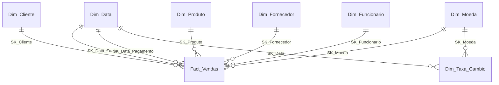

# 02 — Modelo Dimensional, Dicionário de Dados e Estratégias SCD

> Responsável: Leonor (A) · Fases 1 e 2 · Metodologia de Kimball (4 passos)

## 1. Os 4 passos de Kimball

| Passo | Decisão |
|---|---|
| 1. Processo de negócio | **Vendas a clientes (faturação)** da More Rhythm, SA |
| 2. Granularidade | **Uma linha de fatura** (um produto numa fatura). É o nível mais elementar disponível (`invoices_lines`), como o enunciado exige |
| 3. Dimensões | Data (2 papéis), Cliente, Produto, Fornecedor, Funcionário, Moeda |
| 4. Factos | Quantidade, valor líquido, IVA, frete alocado (originais e em EUR) |

**Esquema:** estrela, com uma só tabela de factos (`Fact_Vendas`). Não há *snowflaking*: as hierarquias (zona > cidade, categoria, família) ficam desnormalizadas na dimensão.

### Porquê esta granularidade

1. É o nível mais baixo onde existe produto, quantidade e valor. Dá flexibilidade total: qualquer agregação é feita por *roll up*; o contrário é impossível.
2. Duas análises (2 e 6) cruzam frete ou vendas com **família/produto**, o que só existe ao nível da linha.
3. A granularidade ao nível da fatura perderia o produto, e as análises 1, 2, 5–10 deixariam de ser possíveis.

### Frete (custo de expedição)

O `shipping_cost` está na fatura, não na linha (nas 37 faturas da amostra varia entre 2,5% e 3,1% do total de produtos). Para o ter ao nível da granularidade escolhida:

- **Alocação proporcional ao valor líquido da linha:** `frete_linha = shipping_cost × line_total / Σ line_total da fatura`
- A última linha de cada fatura absorve o resto do arredondamento, para que `Σ frete_linha = shipping_cost`.
- **Alternativas rejeitadas:** (a) repetir o frete em todas as linhas, que duplicaria o valor ao somar; (b) uma tabela de factos ao nível da fatura, que impediria a análise 2 por família; (c) alocar por quantidade, que penaliza artigos baratos.
- **Controlo:** `SUM(frete_alocado)` por fatura tem de ser igual a `invoices.shipping_cost`. Este teste entra no ETL.
- A alocação é feita na **Staging** (decisão partilhada com o Patrick).

### Moeda (Euro como moeda de uniformização)

- Os valores guardam-se em **moeda original** e em **EUR** (`*_eur`), mais a `taxa_cambio` aplicada. Uma só coluna em EUR bastaria para as análises, mas a original preserva a rastreabilidade.
- A taxa é a do **dia da fatura** (`Dim_Taxa_Cambio`, uma linha por moeda e dia; para EUR a taxa é 1).
- Na amostra só existe `EURO`. A estrutura já suporta a sucursal do Reino Unido (GBP) sem alterações.

## 2. Diagrama

Ver [diagrama_modelo_dimensional.png](diagrama_modelo_dimensional.png) e o código Mermaid em [diagrama_modelo_dimensional.mmd](diagrama_modelo_dimensional.mmd).

## 3. Dicionário de dados

Convenções: `SK_` = chave substituta (surrogate key, `int IDENTITY`); `BK_` = chave de negócio vinda da origem. Cada dimensão tem um membro **"Desconhecido"** com SK = −1. **PK** = chave primária, **FK** = chave estrangeira, **N** = nulável. Os tipos são de SQL Server.

### 3.1 `Fact_Vendas`

**Granularidade:** uma linha de fatura. **Chave natural:** `BK_Linha_Fatura` (única).

| Coluna | Tipo | PK/FK | Nulável | Descrição | Origem |
|---|---|---|---|---|---|
| SK_Venda | bigint IDENTITY | PK | N | Chave substituta da linha de factos | — |
| SK_Data_Fatura | int | FK → Dim_Data | N | Data da fatura (papel principal) | `invoices.invoice_date` |
| SK_Data_Pagamento | int | FK → Dim_Data | N | Data de pagamento (papel secundário) | `invoices.payment_date` |
| SK_Cliente | int | FK → Dim_Cliente | N | Versão do cliente à data da venda | `invoices.customer` |
| SK_Produto | int | FK → Dim_Produto | N | Versão do produto à data da venda | `invoices_lines.product` |
| SK_Fornecedor | int | FK → Dim_Fornecedor | N | Fornecedor do produto vendido; **−1 ("Sem fornecedor")** quando `products.supplyer` é nulo (12 produtos na amostra) | `products.supplyer` |
| SK_Funcionario | int | FK → Dim_Funcionario | N | Funcionário que emitiu a fatura | `invoices.employee` |
| SK_Moeda | smallint | FK → Dim_Moeda | N | Moeda original da fatura | `invoices.currency` |
| Numero_Fatura | char(25) | — (dim. degenerada) | N | Identificador da fatura | `invoices.invoice_stamp_id` |
| BK_Linha_Fatura | char(25) | UK | N | Identificador da linha (lineage e carga incremental) | `invoices_lines.invoice_line_stamp_id` |
| Quantidade | decimal(14,4) | — | N | Unidades vendidas (negativa em devoluções) | `invoices_lines.quantity` |
| Preco_Unitario | decimal(19,6) | — | N | Preço unitário, moeda original (não aditivo) | `invoices_lines.unit_price` |
| Valor_Liquido | decimal(19,6) | — | N | Venda sem IVA e sem frete, moeda original | `invoices_lines.line_total` |
| Valor_IVA | decimal(19,6) | — | N | IVA da linha, moeda original | `invoices_lines.line_vat` |
| Frete_Alocado | decimal(19,6) | — | N | Frete repartido pela linha, moeda original | calculado (ver §1) |
| Taxa_Cambio | decimal(18,8) | — | N | Taxa moeda original → EUR no dia da fatura | `Dim_Taxa_Cambio` |
| Valor_Liquido_EUR | decimal(19,6) | — | N | `Valor_Liquido × Taxa_Cambio` | calculado |
| Valor_IVA_EUR | decimal(19,6) | — | N | `Valor_IVA × Taxa_Cambio` | calculado |
| Frete_Alocado_EUR | decimal(19,6) | — | N | `Frete_Alocado × Taxa_Cambio` | calculado |
| Data_Criacao_Origem | datetime2(0) | — | N | `create_date + create_time` da linha | `invoices_lines.create_*` |
| Data_Atualizacao_Origem | datetime2(0) | — | N | `last_update_date + last_update_time` (incremental) | `invoices_lines.last_update_*` |
| ID_Lote_ETL | int | — | N | Execução do ETL que inseriu/atualizou | ETL |

`SK_Data_Pagamento` usa SK −1 ("sem data") quando a fatura ainda não foi paga.

### 3.2 `Dim_Data` (papéis: Data da Fatura, Data de Pagamento)

Carregada uma só vez (por exemplo 2020–2035). **Sem SCD** (valores imutáveis).

| Coluna | Tipo | PK/FK | Nulável | Descrição / exemplo |
|---|---|---|---|---|
| SK_Data | int | PK | N | `yyyymmdd`, ex.: 20250207 |
| Data | date | UK | N | 2025-02-07 |
| Dia_Mes | tinyint | — | N | 7 |
| Dia_Ano | smallint | — | N | 38 |
| Dia_Semana | tinyint | — | N | 1 = segunda … 7 = domingo (ISO) |
| Nome_Dia_Semana | varchar(15) | — | N | Sexta-feira |
| Fim_Semana | bit | — | N | 1 se sábado/domingo (análise 10) |
| Ultimo_Dia_Mes | bit | — | N | 1 se último dia do mês (análise 5) |
| Semana_Ano | tinyint | — | N | Semana ISO 1–53 (análise 6) |
| Ano_Semana_ISO | smallint | — | N | Ano ISO da semana (difere de `Ano` no início/fim do ano) |
| Mes | tinyint | — | N | 2 |
| Nome_Mes | varchar(15) | — | N | Fevereiro |
| Ano_Mes | int | — | N | 202502 (ordenação) |
| Trimestre | tinyint | — | N | 1–4 |
| Quadrimestre | tinyint | — | N | 1–3 (análise 7) |
| Semestre | tinyint | — | N | 1–2 (análise 1) |
| Estacao_Ano | varchar(10) | — | N | Primavera/Verão/Outono/Inverno (análise 8) |
| Ano | smallint | — | N | 2025 |
| Feriado_Nacional | bit | — | N | 1 se feriado em Portugal |
| Nome_Feriado | varchar(60) | — | **S** | Preenchido só nos feriados |

**Estações** (hemisfério Norte, datas astronómicas): Primavera 20/03–20/06 · Verão 21/06–22/09 · Outono 23/09–20/12 · Inverno 21/12–19/03. Os dias de transição variam de ano para ano e ficam registados na tabela em cada ano.

Membro especial: SK = −1 ("Sem data"), usado em `SK_Data_Pagamento` quando não há pagamento.

### 3.3 `Dim_Cliente`

Origem: `customers` + `zones`. **Um cliente = um registo "dourado"** (ver §5, clientes duplicados).

| Coluna | Tipo | PK/FK | Nulável | Descrição | SCD |
|---|---|---|---|---|---|
| SK_Cliente | int IDENTITY | PK | N | Chave substituta | — |
| BK_Cliente | numeric(9,0) | — | N | `customers.number` do registo sobrevivente | — |
| Nome | nvarchar(55) | — | N | Nome | 1 |
| NIF | varchar(20) | — | N | `taxpayer_number` (chave de deteção de duplicados). Em falta/vazio ou `000000000` → `N/D` (1 cliente sem NIF e 1 com `000000000` na amostra) | 1 |
| Contacto | nvarchar(30) | — | **S** | Pessoa de contacto | 1 |
| Email | varchar(45) | — | **S** | Email | 1 |
| Telefone | varchar(60) | — | **S** | `phone` | 1 |
| Telemovel | varchar(45) | — | **S** | `mobile` | 1 |
| Morada | nvarchar(55) | — | **S** | Morada | 1 |
| Codigo_Postal | varchar(45) | — | **S** | Código postal | 1 |
| Cidade | nvarchar(43) | — | N | Cidade (`customers.clity`) | **2** |
| Zona | nvarchar(50) | — | N | Norte, Centro, Sul, Ilhas, Espanha (`zones.zone`). `customers.zone` é nulável na origem (2 clientes na amostra): sem zona → `Zona desconhecida`, nunca inferida | **2** |
| Pais | nvarchar(30) | — | N | Portugal / Espanha (derivado da zona) | 2 (com a zona) |
| Tipo_Cliente | nvarchar(20) | — | N | Cliente Final, Revendedor, Funcionário, Interno | **2** |
| Segmento | nvarchar(25) | — | N | Alto, Médio, Baixo | **2** |
| Vendedor_Atribuido | nvarchar(30) | — | **S** | Nome do funcionário em `customers.seller`; `seller = 0` (4 clientes) significa "sem vendedor" e fica NULL | **2** |
| Dias_Pagamento | smallint | — | **S** | Prazo de pagamento | 1 |
| Data_Inicio | date | — | N | Início de validade da versão | — |
| Data_Fim | date | — | N | Fim de validade (9999-12-31 se atual) | — |
| Versao_Atual | bit | — | N | 1 se for a versão corrente | — |
| Data_Criacao_Origem / Data_Atualizacao_Origem | datetime2(0) | — | N | Rastreabilidade | — |

> Foi **excluído** o IBAN/`BBAN` (dado pessoal/financeiro desnecessário para análise, segundo a política de minimização de dados).

**Hierarquias:**
- **Geográfica:** País > Zona > Cidade > Cliente
- **Por tipo:** Tipo de cliente > Cliente (análise 7: *roll up* até ao tipo)
- **Por segmento:** Segmento > Cliente

### 3.4 `Dim_Produto`

Origem: `products` + `families` + `categories`.

| Coluna | Tipo | PK/FK | Nulável | Descrição | SCD |
|---|---|---|---|---|---|
| SK_Produto | int IDENTITY | PK | N | Chave substituta | — |
| BK_Produto | char(18) | — | N | `products.reference` | — |
| Designacao | nvarchar(60) | — | N | Nome do produto | 1 |
| BK_Familia | varchar(18) | — | N | `families.reference` | — |
| Familia | nvarchar(60) | — | N | Nome da família (Amplificadores, Teclados, …) | **2** |
| Classificacao_Familia | nvarchar(20) | — | **S** | `families.classification` (Instrumentos, Acessórios, …); vazio nalgumas famílias | **2** |
| BK_Categoria | int | — | N | `categories.Code` | — |
| Categoria | nvarchar(35) | — | N | Ar, Cordas, Membranas, … | **2** |
| Classificacao_Produto | nvarchar(20) | — | **S** | `products.classification` | **2** |
| Taxa_IVA | decimal(5,2) | — | **S** | `vat_rate` em vigor | **2** |
| Data_Inicio / Data_Fim / Versao_Atual | date / date / bit | — | N | Controlo SCD2 | — |
| Data_Criacao_Origem / Data_Atualizacao_Origem | datetime2(0) | — | N | Rastreabilidade | — |

**Excluídos:** `stock`, `minimum_stock` (semi-aditivos, pertencem a um modelo de stocks); `current_sell_price` e `last_cost_price` (variam muito, o preço de venda real está no facto).

**Hierarquias** (duas independentes, porque família e categoria são atributos paralelos do produto):
- **Por família:** Classificação > Família > Produto (análises 2, 6, 8, 10)
- **Por categoria:** Categoria > Produto (análises 1, 5, 9)

### 3.5 `Dim_Fornecedor`

Origem: `suplliers` + `zones`. O fornecedor associa-se à linha **via produto** (`products.supplyer`).

| Coluna | Tipo | PK/FK | Nulável | Descrição | SCD |
|---|---|---|---|---|---|
| SK_Fornecedor | int IDENTITY | PK | N | Chave substituta | — |
| BK_Fornecedor | numeric(9,0) | — | N | `suplliers.number` | — |
| Nome | nvarchar(55) | — | N | Nome | 1 |
| NIF | varchar(20) | — | N | `taxpayer_number` | 1 |
| Tipo_Fornecedor | nvarchar(20) | — | N | Material / Serviços | **2** |
| Nacionalidade | nvarchar(20) | — | **S** | Vazia nalguns registos | 1 |
| Cidade | nvarchar(43) | — | N | Cidade | **2** |
| Zona | nvarchar(50) | — | **S** | Zona do fornecedor (análise 10) | **2** |
| Morada / Codigo_Postal | nvarchar(55) / varchar(45) | — | **S** | Endereço | 1 |
| Contacto / Cargo_Contacto | nvarchar(30) / nvarchar(15) | — | **S** | Pessoa de contacto e cargo | 1 |
| Email / Telefone / Telemovel | varchar | — | **S** | Contactos | 1 |
| Dias_Pagamento | smallint | — | **S** | Prazo de pagamento | 1 |
| Data_Inicio / Data_Fim / Versao_Atual | date / date / bit | — | N | Controlo SCD2 | — |

**Hierarquia geográfica:** Zona > Cidade > Fornecedor. A Zona é nulável na origem: nesses casos usa-se "Zona desconhecida".

### 3.6 `Dim_Funcionario`

Origem: `employees`.

| Coluna | Tipo | PK/FK | Nulável | Descrição | SCD |
|---|---|---|---|---|---|
| SK_Funcionario | int IDENTITY | PK | N | Chave substituta | — |
| BK_Funcionario | numeric(5,0) | — | N | `employees.number` | — |
| Codigo | varchar(20) | — | N | `code` (login) | 1 |
| Nome | nvarchar(30) | — | N | Nome | 1 |
| Email | varchar(100) | — | N | Email | 1 |
| Grupo | nvarchar(20) | — | N | Vendedor, Administrativo, Administrador | **2** |
| Departamento | nvarchar(20) | — | N | Armazenagem, Administrativo, Direcção | **2** |
| BK_Chefe | numeric(5,0) | — | **S** | Número do chefe (vazio para a direção) | **2** |
| Nome_Chefe | nvarchar(30) | — | **S** | Nome do chefe | **2** |
| Data_Inicio / Data_Fim / Versao_Atual | date / date / bit | — | N | Controlo SCD2 | — |

**Hierarquias:** Departamento > Grupo > Funcionário, e **Chefe > Funcionário** (hierarquia irregular, pai-filho, achatada em 2 níveis).

### 3.7 `Dim_Moeda` e `Dim_Taxa_Cambio`

| Coluna | Tipo | PK/FK | Nulável | Descrição |
|---|---|---|---|---|
| **Dim_Moeda** | | | | |
| SK_Moeda | smallint | PK | N | Chave substituta |
| Codigo_ISO | char(3) | UK | N | EUR, GBP |
| Nome | nvarchar(30) | — | N | Euro, Libra esterlina |
| Simbolo | nvarchar(3) | — | N | €, £ |
| **Dim_Taxa_Cambio** | | | | |
| SK_Data | int | PK/FK → Dim_Data | N | Dia da cotação |
| SK_Moeda | smallint | PK/FK → Dim_Moeda | N | Moeda origem |
| Taxa_Para_EUR | decimal(18,8) | — | N | 1 unidade de moeda = X EUR |

`Dim_Moeda` tem **SCD 1** (só correções). As taxas são imutáveis (uma linha por dia), logo sem SCD. Na origem `currency = 'EURO'` é mapeado para `EUR`.

## 4. Hierarquias (resumo)

| Dimensão | Hierarquia | Níveis |
|---|---|---|
| Data | Calendário | Ano > Semestre > Trimestre > Mês > Dia |
| Data | Quadrimestre | Ano > Quadrimestre > Mês |
| Data | Semana | Ano ISO > Semana > Dia |
| Data | Estação | Ano > Estação > Dia |
| Produto | Família | Classificação > Família > Produto |
| Produto | Categoria | Categoria > Produto |
| Cliente | Geografia | País > Zona > Cidade > Cliente |
| Cliente | Tipo | Tipo de cliente > Cliente |
| Cliente | Segmento | Segmento > Cliente |
| Fornecedor | Geografia | Zona > Cidade > Fornecedor |
| Funcionário | Organização | Departamento > Grupo > Funcionário |
| Funcionário | Chefia | Chefe > Funcionário |

## 5. Estratégias SCD — resumo e justificação

A origem regista data/hora de criação e de cada alteração (`create_*`, `last_update_*`), mas **não guarda histórico dos valores anteriores**. O histórico começa por isso no primeiro carregamento. A deteção de alterações faz-se por **comparação com a versão atual** (hash das colunas SCD2) nos registos cuja `last_update` seja mais recente que a última carga.

| Tipo | Quando se usa | Efeito |
|---|---|---|
| **SCD 1** (sobrescreve) | Correções e atributos que não explicam resultados passados: nome, NIF, email, telefone, morada, contactos, prazos de pagamento, designação do produto | Atualiza a versão atual; sem histórico |
| **SCD 2** (nova versão) | Atributos que **classificam** o facto e cuja mudança alteraria relatórios passados: zona, cidade, tipo, segmento, vendedor (cliente); família, categoria, classificação, taxa de IVA (produto); zona, cidade, tipo (fornecedor); grupo, departamento, chefe (funcionário) | Fecha a versão atual (`Data_Fim`, `Versao_Atual = 0`) e cria outra |
| Sem SCD | `Dim_Data`, `Dim_Taxa_Cambio` | Imutáveis |

**Justificações-chave:**

- **Cliente com SCD 2 em zona/tipo/segmento:** se um cliente passar de "Centro" para "Norte", as vendas anteriores têm de continuar na zona onde foram feitas. Com SCD 1 isso falsificava as análises 1, 6, 9 e 10.
- **Produto com SCD 2 em família/categoria:** uma reclassificação não pode mover vendas históricas de categoria (análises 1, 5, 9).
- **Funcionário com SCD 2 em grupo/departamento:** permite avaliar o desempenho do funcionário no cargo que tinha na altura.
- **Preços fora das dimensões:** o preço real de venda está no facto; um `preco_atual` na dimensão geraria versões a cada alteração sem valor analítico.
- **Facto:** cada linha aponta para a **versão da dimensão vigente na data da fatura**. A pesquisa de SK na carga usa `Data_Fatura BETWEEN Data_Inicio AND Data_Fim`.
- **Atrasos:** se um facto chegar com data anterior à da versão atual (alteração retroativa), usa-se a versão cujo intervalo contém a data da fatura.

## 6. Clientes duplicados

O data profiling do Patrick (`data-profiling/resultados.md`, §5) classifica os clientes 10 e 18 como **potenciais duplicados** (mesmo NIF normalizado `502323434` e mesmo nome normalizado *EIRA E BEIRA, LDA*; cada um tem 1 fatura, de 90,36 e 471,88). A proposta do modelo é:

- Um **mapa** `Map_Cliente (BK_Origem → BK_Sobrevivente)` é criado na Staging, mantendo sempre os identificadores originais (regra R01 do Patrick: não eliminar nenhum cliente de origem).
- A `Dim_Cliente` só tem os sobreviventes; as faturas dos duplicados apontam para o `SK_Cliente` do sobrevivente, sem perder valores (as duas faturas continuam como duas linhas de factos distintas).
- **Duplicados exatos:** o mesmo NIF (válido, diferente de `N/D` e `000000000`) **e** o mesmo nome normalizado (maiúsculas, acentos, espaços e pontuação). Casos 10 e 18.
- **Duplicados aproximados:** mesmo NIF com nome/morada quase iguais, ou nome muito semelhante com a mesma morada ou email. Regras e limiares a definir com o Patrick; os casos duvidosos **não** são fundidos automaticamente e vão para revisão.
- **Critério do sobrevivente:** o registo com atualização mais recente (`last_update`); em caso de empate, o de menor número.

## 6.1 Tratamento de dados em falta e inválidos (alinhado com as regras R01–R10 do Patrick)

Princípio comum: **atributo descritivo em falta → membro "Desconhecido" (visível, não esconde a venda)**; **identificador, medida ou integridade comprometida → registo rejeitado para a Staging** (fora do Data Mart).

| Situação (amostra) | Regra | Tratamento no Data Mart |
|---|---|---|
| 12 produtos sem fornecedor (R04) | Fornecedor é descritivo | `SK_Fornecedor = −1` ("Sem fornecedor"); a venda é carregada |
| 2 clientes sem zona (R03) | Zona não se infere | `Zona = 'Zona desconhecida'` (e `Pais = 'Desconhecido'`) |
| 1 cliente sem NIF e 1 com `000000000` (R02) | NIF não identifica | `NIF = 'N/D'`; fora da deteção de duplicados |
| Email/telemóvel em falta (R02) | Atributos opcionais | Ficam `NULL` |
| 2 produtos sem designação/família/categoria (R04) | Descritivos | Carregados em `Dim_Produto` com "Desconhecida"; sem vendas na amostra |
| 4 linhas de fatura com `line_total ≠ quantidade × preço` (R06) | Sinal incerto | **Rejeitar a fatura** enquanto a regra de sinal não for confirmada (ver abaixo) |
| 2 faturas com cabeçalho ≠ soma das linhas (R07) | Valor correto desconhecido | **Rejeitar a fatura** |
| 12 linhas de compra sem produto (R05) | — | Fora do âmbito deste data mart (compras); ficam rejeitadas na Staging |

**Porquê rejeitar a fatura inteira, e não só a linha?** O frete é alocado sobre o conjunto das linhas da fatura. Se uma linha fosse retirada, o frete das outras ficava sobrestimado e a soma deixava de reconciliar com `shipping_cost`. Rejeitar a fatura mantém o controlo `Σ frete_alocado = shipping_cost` válido em tudo o que é carregado.

**As 4 linhas (R06):** em todas, `line_total = |quantidade × preço|`. Em 2 casos a quantidade é negativa (−2 × 473; −1 × 662) e noutros 2 o preço é negativo (1 × −140; 10 × −13). Se se confirmar que são devoluções, o modelo já suporta o sinal negativo em `Quantidade` e `Valor_*`, e a regra seria carregar `Valor_Liquido = −|line_total|`; até haver confirmação, ficam rejeitadas.

## 7. Cobertura das análises

Todas as 10 análises estão cobertas pelas dimensões e atributos descritos na [matriz de requisitos](01_matriz_requisitos_analiticos.md). Os atributos exigidos (semestre, quadrimestre, semana, estação, fim de semana, último dia do mês, zona, cidade, tipo de cliente, categoria, família, produto, fornecedor, zona do fornecedor, funcionário) existem todos.

## 8. Pontos em aberto (a fechar com o Patrick)

1. **4 linhas de fatura** com sinal incerto (2 com quantidade negativa, 2 com preço negativo): confirmar se são devoluções. Proposta: rejeitar a fatura até confirmar (§6.1).
2. **2 faturas** com cabeçalho ≠ soma das linhas (145 vs. 140; 234 vs. 239): proposta de rejeição da fatura inteira.
3. Confirmar a política **"Desconhecido" vs. rejeição** (§6.1) com o Patrick e acertar a sua regra R04 (que não rejeita automaticamente atributos descritivos em falta).
4. Regras de **duplicados aproximados** (limiares) e critério do sobrevivente.
5. Definição de **"vendas com IVA"** (com ou sem frete), ver [matriz](01_matriz_requisitos_analiticos.md).
6. **Classificação**: `products.classification` vs. `families.classification` (as duas existem; a do produto está vazia em 2 produtos).
7. **Expansão futura:** quando existir uma sucursal no Reino Unido, acrescentar `Dim_Filial` à tabela de factos (com um membro "Sede Porto" para o histórico).
