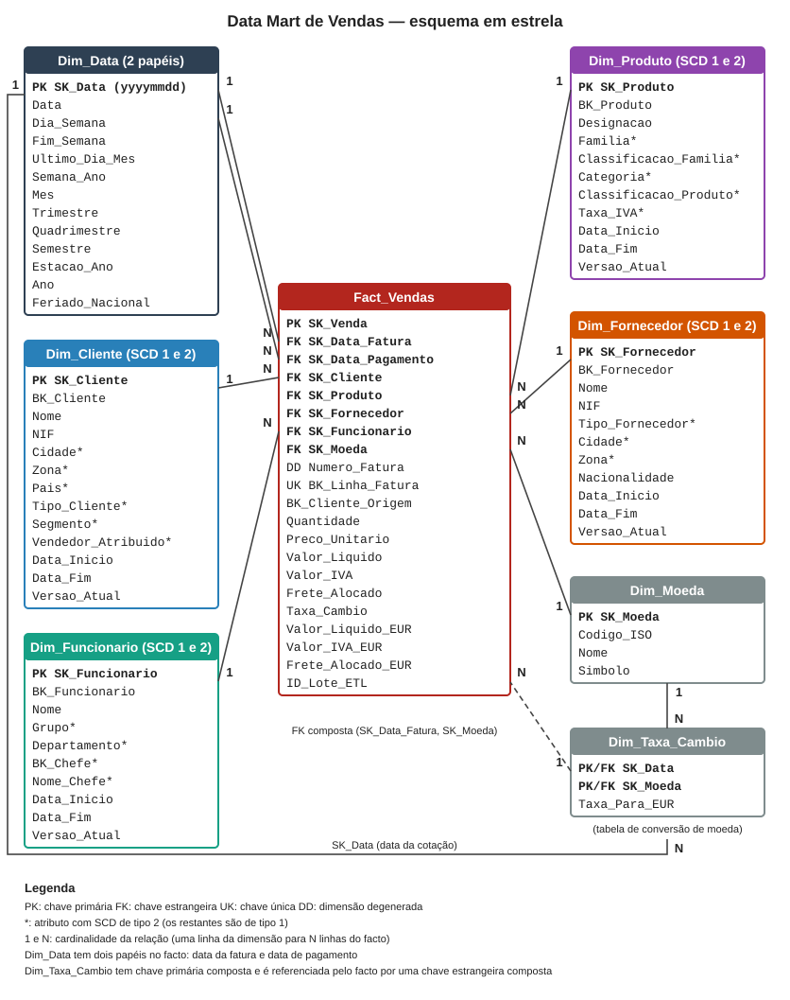

# Introdução

O trabalho consiste em desenvolver um *data mart* com as vendas (faturação) da More Rhythm, SA, empresa sediada no Porto que distribui instrumentos musicais em Portugal e, pontualmente, em Espanha. A gestão quer analisar historicamente as vendas feitas a clientes, e o enunciado pede que o *data mart* permita fazê-lo ao nível de detalhe mais elementar. Este relatório corresponde à 1.ª parte e reúne o que o enunciado lhe atribui: a arquitetura do armazém de dados, o modelo dimensional com os atributos e tipos de dados de cada dimensão e da tabela de factos, as estruturas de dados da *staging area*, os mapeamentos entre a origem e a *staging area* e entre esta e o armazém de dados (com a estratégia de *Slowly Changing Dimension* de cada atributo) e as operações de transformação e limpeza.

Os dados disponíveis são uma amostra da base `MoreRhythm`: 12 tabelas de negócio com 1 057 registos, dos quais 37 faturas e 93 linhas de fatura, emitidas entre 31/01/2025 e 01/05/2025. O enunciado indica que o volume real é muito superior e que a amostra é representativa. Como a amostra termina em maio, algumas das análises pedidas (a da primavera e as do 2.º trimestre, por exemplo) só têm dados de parte do período; isso resulta da amostra e não do modelo.

**Estado do trabalho.** Fizeram-se o *profiling* da origem, o desenho do modelo dimensional e da *staging area*, os mapeamentos e as regras de limpeza, e escreveram-se em SQL Server e testaram-se as estruturas físicas do *data mart* e da *staging area*. O processo ETL no *Integration Services Project*, as consultas e as 20 análises em Power BI pertencem à 2.ª parte; por isso a secção sobre o ETL descreve o que se pretende construir e não um processo já executado. As regras de transformação e limpeza têm os identificadores R01 a R11, e os *scripts* e documentos de trabalho estão no repositório do projeto.

# Arquitetura do armazém de dados

A arquitetura tem quatro camadas, ligadas por um processo ETL implementado num *Integration Services Project* do Visual Studio. A separação entre a *staging area* e o *data mart* segue a organização habitual do método de Kimball, em que os dados são preparados numa área própria antes de serem publicados no esquema dimensional. Neste trabalho a *staging area* tem ainda uma função que o enunciado impõe: guardar os registos com problemas de qualidade que não se corrigem automaticamente, que ficam fora do *data mart*.

| Camada | Base de dados | Função | Justificação |
|---|---|---|---|
| Sistema operacional | `MoreRhythm` | Origem dos dados. É apenas lida; o processo nunca a altera | O sistema operacional continua a servir a empresa; as colunas de auditoria permitem extrair só o que mudou |
| Staging Area | `MoreRhythm_STG` | Copia os registos extraídos, valida-os, normaliza-os, consolida os clientes duplicados e isola os registos com problemas de qualidade | Separa a preparação dos dados do *data mart* e é onde o enunciado manda guardar o que não se corrige automaticamente; nas aulas é a área onde se limpa, integra e elimina duplicados e que os utilizadores não acedem |
| Data Mart | `MoreRhythm_DM` | Esquema em estrela com uma tabela de factos e as dimensões, pronto para consulta | A estrela é simples e rápida de consultar; o nível de detalhe mais fino (atómico) permite análises que não se preveem |
| Análise | Power BI | As 20 análises multidimensionais pedidas | Requisito do enunciado; só lê o *data mart* |

A *staging area* e o *data mart* ficam no mesmo servidor, em duas bases de dados, como o enunciado indica. Escolheu-se a arquitetura BUS e não a *Corporate Information Factory* porque o trabalho é um único *data mart*, de um processo de negócio (as vendas), e porque as aulas indicam que a BUS é *bottom-up*, com menor complexidade e custo iniciais, enquanto a *Corporate Information Factory* exige primeiro um armazém central normalizado.

A arquitetura corresponde à *Data Warehouse BUS Architecture* de Kimball, que o enunciado impõe ao pedir a metodologia de Kimball. A *back room* (aquisição e preparação dos dados) é a *staging area* com o processo ETL: extração, transformação, carga e controlo das execuções (`stg_load_control`, o catálogo de metadados do processo). A área de apresentação é um *data mart* atómico, com o menor detalhe disponível (uma linha por linha de fatura), dimensional e construído sobre dimensões que outros processos de negócio poderão reutilizar, como as compras e os movimentos de stock, cujas tabelas a *staging area* já copia. A *front room* é a camada de análise em Power BI. O *data mart* tem as quatro características do armazém de dados apresentadas nas aulas: é orientado a um assunto (as vendas), integrado (os dados são limpos e os clientes duplicados consolidados), variável no tempo (a dimensão de datas e o histórico das dimensões por SCD) e não atualizável pelos utilizadores (só o processo ETL escreve nele, por carga). Ao contrário da *Corporate Information Factory*, não há um armazém normalizado intermédio: a *staging area* não é acessível aos utilizadores.

**Fluxo de um lote de carga.**

1. **Extração:** cada tabela de origem é copiada para a *staging area* com o identificador do lote (`load_id`) e o instante da extração. Onde as colunas de auditoria da origem são fiáveis, só se leem os registos novos ou alterados; nas restantes lê-se a tabela inteira e compara-se por valor de resumo (secção «Processo ETL»).
2. **Validação e limpeza:** aplicam-se as regras R01 a R11. Cada registo fica `VALID`, `CORRIGIDO`, `PENDING` ou `REJECTED`. A normalização é feita em cópias de comparação e o valor original nunca se perde.
3. **Rejeição:** os registos que não podem ser corrigidos automaticamente são copiados para tabelas próprias da *staging area* (tabelas DQP, `dqp_<origem>`, como nas aulas práticas), com a regra violada e a descrição do problema, e não são carregados no *data mart*, como o enunciado exige. Uma fatura com uma linha ou um total incoerente é rejeitada por inteiro.
4. **Duplicados:** os clientes duplicados, iguais ou aproximadamente iguais, são consolidados num sobrevivente, e o mapa fica guardado na *staging area*.
5. **Carga do *data mart*:** as dimensões carregam antes do facto, e só entram registos `VALID` ou `CORRIGIDO`. A carga é incremental e idempotente.
6. **Frete e moeda:** o frete, que na origem está ao nível da fatura, é repartido pelas linhas durante a validação, e os valores são convertidos para euros na transformação.

**Parametrização.** O projeto SSIS não tem caminhos absolutos. O servidor e a base de dados do sistema operacional, o servidor do *data mart* e da *staging area* (o mesmo para ambas) e os nomes das bases de dados do *data mart* e da *staging area* vêm de parâmetros do projeto, como o enunciado exige; a lista completa está na secção «Processo ETL».

# Data Profiling

O *profiling* foi feito sobre a `MoreRhythm` com sete *scripts* SQL (inventário, chaves e relações, valores em falta, duplicados de clientes, inconsistências financeiras, integridade referencial, e validação de domínio com duplicados aproximados). Todas as consultas são de leitura. O resultado detalhado e os *scripts* estão em `data-profiling/`.

## Modelo relacional da origem

A origem tem 12 tabelas de negócio e 16 chaves estrangeiras declaradas, que coincidem com as do diagrama do enunciado.

| Tabela | Registos | Referências (chave estrangeira) |
|---|---:|---|
| `zones` | 5 | — |
| `categories` | 11 | — |
| `families` | 17 | — |
| `employees` | 6 | `chief` → `employees` |
| `suplliers` | 14 | `zone` → `zones` |
| `customers` | 26 | `zone` → `zones` |
| `products` | 67 | `category` → `categories`; `family` → `families`; `supplyer` → `suplliers` |
| `invoices` | 37 | `customer` → `customers`; `employee` → `employees` |
| `invoices_lines` | 93 | `invoice_stamp_id` → `invoices`; `product` → `products` |
| `purchases` | 18 | `supplier` → `suplliers`; `employee` → `employees`; `zone` → `zones` |
| `purchases_lines` | 77 | `purchase_stamp` → `purchases`; `product` → `products` |
| `stocks_movements` | 686 | `product` → `products` |

Existe ainda uma relação não declarada, `customers.seller` → `employees`, sem registos órfãos. Os testes de integridade referencial não encontraram registos sem correspondência. Tanto a venda como a compra têm o valor ao nível da fatura (cabeçalho) e da linha, e o custo de expedição das vendas (`shipping_cost`) está só no cabeçalho, o que obriga a alocá-lo às linhas.

## Problemas encontrados

| Problema | Evidência | Tratamento |
|---|---|---|
| Clientes duplicados | 3 pares: 10 e 18 (iguais), 8 e 22 e 5 e 26 (aproximados); 9 de 37 faturas, 12 831,12 (26,0 % do valor) | Consolidados no sobrevivente (R01) |
| NIF de cliente não identificativo | 4 clientes: vazio, `0`, `00` e `000000000` | `N/D`; fora da deteção de duplicados (R02) |
| Zona em falta | 2 clientes (2 e 20) e 2 fornecedores (3 e 13) | Não se infere: o registo é rejeitado (R03); nenhuma fatura é afetada |
| Atributos de produto em falta | 2 produtos sem designação, família nem categoria (`Z001`, `CORSR`); 12 produtos sem fornecedor | Os 2 produtos são rejeitados (R04); o fornecedor em falta usa o membro «Sem fornecedor» |
| Email e telemóvel | Email ausente em 12 clientes e inválido em 1; telemóvel ausente em 21 | `NULL` (R02) |
| Emails de funcionários | 2 com dois `@` | `NULL` (R02) |
| Datas de auditoria invertidas | `last_update` anterior à criação em 8 de 67 produtos e 8 de 14 fornecedores | A carga incremental usa também o *hash* |
| Linhas de compra sem produto | 12 linhas, quantidade 319, valor 12 615,30 | Rejeitadas na *staging area*; fora do âmbito do *data mart* de vendas (R05) |
| Linhas de fatura com `line_total` ≠ quantidade × preço | 4 linhas (2 com quantidade negativa, 2 com preço negativo) | Fatura rejeitada até confirmar a regra de sinal (R06) |
| Cabeçalho ≠ soma das linhas | 2 faturas, diferenças de +5,00 e −5,00 | Fatura rejeitada (R07) |
| Frete incoerente | 2 faturas com `shipping_cost` superior em 2,50 e 5,00 ao frete incluído no total (2,5 % dos produtos nas outras 35) | Fatura rejeitada (R11) |

Há uma única taxa de IVA (23 %), na origem e nas 93 linhas de fatura, e o IVA incide sobre os produtos e não sobre o frete.

Por dimensão de qualidade dos dados, os problemas distribuem-se assim: *unicidade* (clientes duplicados); *completude* (NIF, zona, atributos de produto, contactos e linhas de compra sem produto); *validade* (formato de emails e NIF); *consistência* (linhas, cabeçalhos e frete das faturas, e datas de auditoria); *integridade* (sem registos órfãos nas 16 relações declaradas nem na relação implícita).

## Duplicados de clientes

A igualdade exata do NIF e do nome só encontra o par 10 e 18. Como o enunciado indica que a repetição pode não ser rigorosamente igual, compararam-se todos os pares de clientes por semelhança: o nome (distância de Levenshtein normalizada, mínimo de 0,80) tem de ser acompanhado de pelo menos dois de seis atributos corroborantes (código postal, morada, telefone, email, BBAN, NIF com diferença até duas posições). O critério encontra os três pares e nenhum outro; a semelhança mais alta entre os restantes pares (fora os dois clientes internos, que não têm atributos corroborantes) é 0,59. Os pares 8 e 22 e 5 e 26 têm NIF que diferem em duas posições, e o dígito de controlo não permite dizer qual está correto, porque os quatro falham a verificação, tal como a maior parte dos NIF da amostra. A regra e a escolha do sobrevivente estão na secção «Regras de transformação, limpeza e rejeição». Os fornecedores 8 e 14 têm o mesmo NIF, mas localidade, zona e produtos diferentes, e não se consideram duplicados.

## Impacto das rejeições

Na amostra, as regras de rejeição de faturas (R06, R07 e R11) afetam 7 das 37 faturas, 11 das 93 linhas e 4 989,88 dos 49 341,33 faturados (10,1 % do valor).

| Regra | Faturas | Valor |
|---|---:|---:|
| R06: linha com valor diferente de quantidade × preço | 4 | 2 362,02 |
| R07: cabeçalho diferente da soma das linhas | 2 | 475,65 |
| R11: frete incoerente (só esta regra) | 2 | 2 333,05 |
| Total, sem repetir faturas | 7 | 4 989,88 |

Uma fatura é apanhada simultaneamente por R06 e R07, pelo que a soma por regra excede o total. As 12 linhas de compra sem produto e os dois clientes e dois produtos rejeitados por R03 e R04 não afetam nenhuma fatura.

**Confirmado e por confirmar.** Os números foram obtidos por consultas à origem. A interpretação dos sinais negativos (devoluções ou erro de dados), o significado de `invoices.payment_date` (sempre preenchida, entre 03/02 e 31/12/2025 e nunca anterior à fatura, pelo que pode ser uma data de vencimento) e a origem do `shipping_cost` das duas faturas em R11 dependem de confirmação e estão nas decisões em aberto.

# Modelo dimensional

@@include ../modelo-dimensional/03_relatorio_seccao_modelo_dimensional.md shift=0

A figura mostra a tabela de factos, as dimensões e as relações entre elas, com a cardinalidade (uma linha da dimensão para N linhas do facto). O dicionário completo de dados, com tipos, chaves e nulabilidade, está no Anexo B. As restrições físicas (chave estrangeira composta do facto para a tabela de taxas, vigência dos atributos de tipo 2 e índice único da versão corrente) estão na secção seguinte.

## Implementação física

O esquema foi implementado em SQL Server (`04_ddl_data_mart.sql`) e validado com 34 testes automáticos (chaves, restrições, tipos, calendário e SCD2), todos aprovados numa base de dados descartável. A `Dim_Data` é populada de 2020 a 2035, com feriados nacionais (incluindo os móveis, calculados a partir da Páscoa) e as taxas de câmbio EUR = 1. Os tipos das chaves de negócio coincidem com os da origem (`numeric(10,0)` para clientes e fornecedores, `numeric(6,0)` para funcionários).

# Staging Area

A Staging Area é a camada onde os dados extraídos são guardados, validados e separados antes de chegarem ao Data Mart. Está na base de dados `MoreRhythm_STG`, no mesmo servidor do Data Mart, e nela ficam, por exigência do enunciado, os registos com problemas de qualidade que não se corrigem automaticamente.

## Estruturas de dados

A Staging tem 20 tabelas, descritas no Anexo C.

| Tabela | Função |
|---|---|
| `stg_<origem>` (12 tabelas) | Cópia de cada tabela de origem, com os mesmos nomes de coluna, tipos, precisão e nulabilidade, mais nove colunas técnicas (abaixo) e algumas colunas auxiliares de validação |
| `dqp_<origem>` (6 tabelas) | Registos rejeitados, no padrão DQP (*Data Quality Problems*) das aulas práticas: os atributos do registo de origem, a regra violada e a descrição do problema. Existem para clientes, fornecedores, produtos, faturas, linhas de fatura e linhas de compra |
| `stg_load_control` | Uma linha por execução de carga: sistema de origem, início e fim, contagens (extraídas, validadas, rejeitadas), estado (`RUNNING`, `SUCCEEDED`, `FAILED`) e mensagem de erro |
| `stg_customer_duplicate_groups` | Uma linha por cliente de origem pertencente a um grupo de duplicados: grupo, sobrevivente, semelhança do nome, atributos corroborantes, estado da decisão (`ACTIVE`, `DISMISSED`) e carga em que foi tomada |

As colunas auxiliares calculam-se na Staging e não existem na origem: `frete_alocado` (linhas de fatura), `line_sum` e `header_line_difference` (faturas), `normalised_name`, `normalised_taxpayer`, `normalised_email` e `normalised_address` (clientes, apenas para comparação) e `classification_fallback` (produtos).

### Tabelas e ficheiros

O enunciado pede as «estruturas de dados (tabelas; ficheiros)» da Staging. Nas aulas práticas os dados chegavam em ficheiros `.dat` carregados para tabelas da Staging; aqui a origem é uma base de dados SQL Server, pelo que a extração é feita diretamente para tabelas e a Staging não tem ficheiros de dados. Os ficheiros do projeto são os *scripts* SQL de criação das estruturas e o ficheiro de parâmetros do projeto SSIS (`Project.params`).

### Decisões de desenho

- **Cópia sem conversão.** Os valores da origem são guardados com o mesmo tipo e sem transformação; um `NULL` continua `NULL`. As normalizações usam colunas auxiliares e o valor original nunca se perde.
- **Histórico por carga.** As tabelas da Staging não são esvaziadas em cada execução: a mesma chave de origem pode existir em cargas diferentes, mas não duas vezes na mesma (`UNIQUE (load_id, source_pk)`). Conservar os dados já extraídos permite compará-los com os da carga seguinte, como se descreve na extração.
- **Rejeitados em tabelas DQP.** Os registos que não se corrigem automaticamente são copiados para a tabela DQP da sua origem, com a regra e a descrição do problema, e não seguem para o Data Mart. Os valores de origem ficam também na tabela `stg_<origem>`, com o estado `REJECTED`. A correção e a carga posterior destes registos estão fora do âmbito do trabalho.
- **Rejeição ao nível da fatura.** Uma rejeição por R06, R07 ou R11 marca a fatura inteira, porque o frete é alocado sobre o conjunto das linhas. Na amostra são rejeitadas 7 das 37 faturas (10,1 % do valor).
- **Decisão persistente nos duplicados.** A decisão de consolidar dois clientes fica gravada e só se desfaz por revisão explícita; recalculá-la em cada carga separaria um cliente absorvido do sobrevivente quando um atributo mudasse e partiria o histórico das faturas.

### Colunas técnicas

@@include ../mappings/source-to-staging.md from="## 9. Contrato físico" to="### 9.1" shift=0 drop_heading=1

### Validação das estruturas

As estruturas foram criadas e testadas em SQL Server (`mappings/03_ddl_staging_area.sql`, `05_ddl_staging_tabelas_tipadas.sql` e `06_testes_staging.sql`), numa base de dados descartável. Os 39 testes verificam a existência das tabelas, a igualdade de tipo, tamanho e nulabilidade de cada coluna de negócio face à origem (143 colunas nas tabelas `stg_<origem>` e as das seis tabelas DQP), as colunas técnicas, as chaves e restrições e o comportamento com dados de teste (valores por omissão, duplicados, estados inválidos, registos rejeitados e grupos de duplicados). Todos foram aprovados.

# Processo ETL

Esta secção especifica o processo ETL, que será implementado na 2.ª parte num *Integration Services Project* do Visual Studio, com os componentes usados nas aulas práticas. Nada foi ainda construído. A lógica de carga foi experimentada em T-SQL sobre a amostra (pasta `prototipo-carga` do repositório), o que permitiu fixar as regras e os resultados esperados; o protótipo valida a lógica e não é o processo em SSIS.

## Projeto e parâmetros

O projeto tem um pacote, `Data Mart ETL Package`, organizado em contentores (*Sequence Container*), como nas aulas. Nenhum componente tem nomes de servidores, de bases de dados ou caminhos fixos: tudo vem de parâmetros do projeto (`Project.params`). Os gestores de ligação usam expressões que ligam as propriedades `ServerName` e `InitialCatalog` aos parâmetros, e os *Foreach Loop Container* usam o parâmetro da pasta do projeto.

| Parâmetro | Conteúdo |
|---|---|
| `Origem_Servidor` | Servidor da base de dados do sistema operacional |
| `Origem_BD` | Base de dados do sistema operacional (`MoreRhythm`) |
| `DW_Servidor` | Servidor do Data Mart e da Staging (o mesmo para ambos) |
| `DM_BD` | Base de dados do Data Mart (`MoreRhythm_DM`) |
| `STG_BD` | Base de dados da Staging (`MoreRhythm_STG`) |
| `Caminho_Pacote` | Pasta do projeto, onde estão os *scripts* SQL |

Os cinco primeiros são os que o enunciado exige; o último serve a leitura dos *scripts* de criação das estruturas.

## Ordem de execução

| Ordem | Componente | Função |
|---|---|---|
| 1 | Duas *Execute SQL Task* (ligação ADO.NET à base `master`) | Criar as bases da Staging e do Data Mart se ainda não existirem, com o nome recebido de um parâmetro |
| 2 | Dois *Foreach Loop Container* (*Foreach File Enumerator*, `*.sql`) com uma *Execute SQL Task* cada | Executar os *scripts* de criação das tabelas da Staging e do Data Mart; só criam as tabelas que ainda não existem |
| 3 | *Execute SQL Task* | Abrir o lote em `stg_load_control` (estado `RUNNING`) e guardar o `load_id` numa variável |
| 4 | *Sequence Container* «Load Temporal Dimensions» | Carregar `Dim_Data` e `Dim_Taxa_Cambio`, só se estiverem vazias |
| 5 | *Sequence Container* «Extract to Staging» | 12 *Data Flow Task*, um por tabela de origem |
| 6 | *Execute SQL Task* em sequência | Validação e limpeza (regras R02 a R11, frete alocado) e preenchimento das tabelas DQP |
| 7 | *Data Flow Task* «Customer Duplicates» | Deteção de clientes duplicados (R01) |
| 8 | *Sequence Container* «Load Business Dimensions» | 4 *Data Flow Task*: cliente, produto, fornecedor e funcionário |
| 9 | *Execute SQL Task*, *Data Flow Task* «Load Fact_Vendas», *Execute SQL Task* | Apagar as chaves estrangeiras do facto, carregar o facto e recriar as chaves |
| 10 | *Execute SQL Task* | Reconciliação e fecho do lote (`SUCCEEDED`) |

A restrição de precedência de falha dos componentes anteriores leva a uma *Execute SQL Task* que marca o lote `FAILED` com a mensagem de erro. As dimensões só carregam depois do passo 7, porque a chave do cliente no Data Mart depende do mapa de duplicados. A propriedade `DelayValidation` das tarefas que dependem de objetos criados durante a execução fica a `True`.

## Dimensões temporais e de moeda

Como no tutorial da dimensão de datas, um *Data Flow Task* «Is Dim_Data Empty?» (*OLE DB Source* e *Row Count* para uma variável) e uma restrição de precedência com expressão decidem se executa a *Execute SQL Task* que corre o *script* `05_carga_dim_data_moeda.sql`, que preenche `Dim_Data` (2020 a 2035) e as taxas de câmbio (EUR = 1). Assim a carga repetida não duplica registos.

## Extração para a Staging

Cada tabela de origem tem um *Data Flow Task*: *OLE DB Source* (consulta à origem) → *Derived Column* (`load_id`, `extraction_timestamp` e `source_pk`) → *OLE DB Destination*. A 1.ª carga é uma extração estática (todos os registos, para preencher o *data mart*); as seguintes são incrementais, como se apresentou nas aulas.

- **Tabelas com datas de auditoria fiáveis** (`customers`, `employees`, `families`, `invoices`, `invoices_lines`, `purchases`, `purchases_lines`, `stocks_movements`): a consulta só devolve os registos com `last_update` igual ou posterior ao maior já guardado na Staging em lotes `SUCCEEDED`. O filtro corre na origem, por isso só os registos novos ou alterados atravessam a rede.
- **Tabelas sem auditoria fiável** (`zones` e `categories`, que não têm datas de auditoria, e `products` e `suplliers`, onde 8 de 67 e 8 de 14 registos têm `last_update` anterior à criação): a extração é estática e compara-se com o que já está na Staging por valor de resumo, a técnica do CRC apresentada nas aulas. A consulta calcula o `raw_row_hash` (função `SHA2_256` do SQL Server, em vez de um CRC); um *Lookup* procura o último registo guardado com a mesma chave e um *Conditional Split* separa os registos novos (sem correspondência), alterados (resumo diferente) e iguais, que são descartados.

## Validação e limpeza

As regras aplicam-se em *Execute SQL Task* sobre o lote, e cada registo rejeitado é copiado (`INSERT ... SELECT`) para a tabela DQP da sua origem, com a regra violada e a descrição do problema; o estado do registo em `stg_<origem>` passa a `REJECTED`.

1. **Normalização** (R02, R09): preencher as colunas `normalised_*` e tratar como ausente o valor vazio, só com espaços ou com formato inválido, nas colunas transformadas; o valor original fica na coluna copiada.
2. **Atributos em falta** (R03, R04): rejeitar os clientes e fornecedores sem zona e os produtos sem designação, família ou categoria.
3. **Linhas e faturas** (R05, R06, R07, R11): marcar a linha de compra sem produto; comparar `line_total` com `quantity × unit_price`; calcular `line_sum` e `header_line_difference`; comparar `final_total` com `products_total + shipping_cost + vat_value`. A tolerância monetária é 0,01. Uma violação de R06, R07 ou R11 rejeita a fatura inteira.
4. **Integridade** (R08): rejeitar a fatura cujo cliente ou produto não existe ou foi rejeitado.
5. **Frete**: nas faturas não rejeitadas, `frete_alocado` é proporcional ao valor da linha, com o resto de arredondamento na última linha.
6. **Estado**: os restantes registos passam a `VALID` ou `CORRIGIDO` e são os únicos que a carga lê.

## Deteção de duplicados de clientes

O *Data Flow Task* lê os clientes do lote que ainda não têm decisão em `stg_customer_duplicate_groups`, juntamente com os sobreviventes `ACTIVE`, e passa o nome normalizado pelo componente *Fuzzy Grouping*, que agrupa por semelhança e devolve a chave do grupo e a pontuação. O componente só mede a semelhança do nome; o critério completo da regra R01 (pelo menos dois atributos corroborantes) aplica-se a seguir, numa *Execute SQL Task* sobre os pares candidatos, que também escolhe o sobrevivente (a atualização mais recente). Ficam gravados os grupos em que pelo menos um membro ainda não tinha decisão. A semelhança do componente não é a medida usada no *profiling*; o seu limiar tem de ser calibrado na 2.ª parte sobre os mesmos pares, e o resultado esperado na amostra é o mesmo: três grupos, com sobreviventes 18, 8 e 5.

## Carga das dimensões

Quatro *Data Flow Task* (cliente, produto, fornecedor e funcionário) seguem o mesmo padrão:

1. *OLE DB Source*: consulta que junta as tabelas `stg_` envolvidas e devolve só os registos `VALID` ou `CORRIGIDO` do lote (na dimensão do cliente, só os sobreviventes do mapa de duplicados).
2. *Derived Column*: aplica as transformações do mapeamento e calcula dois valores de resumo, `Hash_SCD1` (atributos de tipo 1) e `Hash_SCD2` (atributos de tipo 2).
3. *Lookup*: procura a versão corrente da dimensão (`Versao_Atual = 1`) pela chave de negócio.
4. *Conditional Split* com quatro saídas:
   - **sem correspondência**: *OLE DB Destination* insere a 1.ª versão, com início em 1900-01-01, porque a origem não guarda os valores antigos e a primeira versão tem de cobrir todo o passado;
   - **`Hash_SCD1` diferente**: *OLE DB Command* atualiza os atributos de tipo 1 em todas as versões da chave;
   - **`Hash_SCD2` diferente**: *OLE DB Command* fecha a versão corrente (`Data_Fim` e `Versao_Atual = 0`) e *OLE DB Destination* insere a nova versão, com início na data da alteração na origem;
   - **resumos iguais**: não faz nada, pelo que repetir o lote é inofensivo.

É a mesma lógica do componente *Slowly Changing Dimension* das aulas (chave de negócio, atributos de tipo 1 e de tipo 2, datas de início e fim e indicador de versão corrente). Usam-se o *Lookup* e o *Conditional Split* porque o componente *SCD* consulta a dimensão linha a linha e, como se vê nas aulas, só fica rápido com um índice na chave de negócio; o *Lookup* mantém a dimensão em memória e o valor de resumo evita comparar os atributos um a um. O índice na chave de negócio existe na mesma (`IX_Dim_*_Atual`). O método usado é o do resumo (CRC) apresentado nas aulas: se o resumo coincide o registo não mudou; se não coincide, os dois resumos dizem que tipo de alteração ocorreu.

Os clientes e fornecedores sem zona e os produtos sem designação, família ou categoria não entram nas dimensões e ficam nas tabelas DQP; na amostra isso não afeta nenhuma fatura (clientes 2 e 20; fornecedores 3 e 13; produtos `Z001` e `CORSR`). O membro `SK = −1` de cada dimensão existe desde a criação do esquema; só o fornecedor o usa em dados reais (12 produtos sem fornecedor).

## Carga da tabela de factos

O *Data Flow Task* «Load Fact_Vendas» segue o tutorial da tabela de factos:

1. *OLE DB Source*: consulta que junta `stg_invoices_lines` e `stg_invoices`, só com faturas não rejeitadas; o cliente passa pelo mapa de duplicados.
2. Um *Lookup* por dimensão (data da fatura, data de pagamento, cliente, produto, fornecedor do produto, funcionário, moeda e taxa de câmbio), limitado à versão corrente nas dimensões com SCD de tipo 2. As linhas sem correspondência vão para a saída de erro, recebem a descrição do problema numa *Derived Column* e, reunidas por um *Union All*, seguem para `dqp_invoices_lines`.
3. *Lookup* «Fact Already Exists?», por `BK_Linha_Fatura`: sem correspondência a linha é nova e vai para o *OLE DB Destination*.
4. *Lookup* «Fact Equal?», que compara o `Hash_Linha`: sem correspondência a linha mudou e um *OLE DB Command* «Update Fact_Vendas» atualiza-a.

Quantidade, preço, valor líquido e IVA copiam-se da linha, sem alterar o sinal. O frete é o `frete_alocado` calculado na validação. Os valores em euros são o valor original vezes a taxa do dia da fatura, arredondados a seis casas. `BK_Cliente_Origem` guarda o cliente de origem antes de consolidar duplicados e `ID_Lote_ETL` o lote. O `Hash_Linha` é o resumo da linha e do cabeçalho da fatura, porque uma alteração ao frete no cabeçalho muda a alocação de todas as linhas sem alterar as linhas. Como as faturas são carregadas quando existem, a versão corrente da dimensão é a que vigorava na data da fatura; uma alteração retroativa a um atributo de tipo 2 não reaponta factos já carregados.

Antes da carga uma *Execute SQL Task* apaga as chaves estrangeiras do facto (se existirem) e depois outra recria-as, como no tutorial, para a carga ser mais eficiente.

## Reconciliação, erros e repetição

A última *Execute SQL Task* faz, depois de cada carga, os controlos seguintes; se algum falhar, o lote fica `FAILED`.

| Controlo | Resultado esperado na amostra |
|---|---|
| Faturas e linhas carregadas igual às válidas da Staging | 30 de 37 faturas e 82 de 93 linhas (ficam de fora as 7 faturas rejeitadas e as suas 11 linhas) |
| `Σ Frete_Alocado` por fatura igual a `shipping_cost` | diferença zero |
| `Σ (Valor_Liquido + Valor_IVA + Frete_Alocado)` por fatura igual a `final_total` (tolerância 0,01) | diferença zero |
| `Σ Valor_Liquido` igual à soma de `products_total` das faturas carregadas | os dois valores coincidem |
| As faturas dos clientes de cada par duplicado apontam para o mesmo `SK_Cliente` | sim; `BK_Cliente_Origem` guarda os dois clientes |
| Repetir a carga | 0 linhas inseridas e 0 atualizadas |

Repetir a execução é seguro: as dimensões e o facto só inserem o que não existe e só atualizam o que mudou, e a marca de extração só considera lotes `SUCCEEDED`, pelo que um lote que falhou é lido de novo.

## Eficiência

O enunciado exige que o processo seja o mais eficiente possível e indica que o volume real é muito superior ao da amostra. As medidas adotadas são as que se viram nas aulas:

- extração incremental pelas colunas de auditoria da origem, com o filtro executado na base de dados de origem, e comparação por valor de resumo (CRC) nas tabelas sem auditoria fiável;
- consultas de origem que escolhem só as colunas necessárias e fazem as junções e agregações na base de dados, como na consulta do facto;
- *Lookup* com a dimensão em memória em vez de uma consulta por linha, e índice na chave de negócio das dimensões;
- chaves estrangeiras do facto apagadas antes da carga e recriadas depois.

Não foram feitas medições de desempenho: a amostra é pequena. Ficam para a 2.ª parte.

## Duplicado detetado depois da carga

Se um duplicado só for detetado quando os dois clientes já foram carregados em separado, o mapa passa a ter uma decisão nova e é preciso reapontar as faturas já carregadas. O reapontamento fica especificado e não é implementado nesta fase: os factos dos clientes absorvidos (`BK_Cliente_Origem`) passam à versão corrente do sobrevivente num só `UPDATE`, e as linhas desses clientes são depois removidas da dimensão para que ela fique com uma linha por cliente real. O histórico fica em `BK_Cliente_Origem` e no mapa da Staging.

# Mapeamentos

## Origem → Staging

A cópia é 1:1: cada tabela de origem tem a sua `stg_<origem>`, com as mesmas colunas, tipos, precisão e nulabilidade; os `NULL` mantêm-se `NULL` e nenhuma conversão é destrutiva. A tabela técnica `sysdiagrams` não é copiada. As regras de validação aplicadas na passagem para a Staging são as seguintes.

O quadro seguinte mostra o percurso de cada tabela de origem, da Staging ao *data mart*.

| Tabela de origem | Tabela da Staging | Destino no Data Mart |
|---|---|---|
| `customers` | `stg_customers` | `Dim_Cliente` (com o mapa de duplicados) |
| `zones` | `stg_zones` | Zona e país em `Dim_Cliente`; zona em `Dim_Fornecedor` |
| `employees` | `stg_employees` | `Dim_Funcionario`; vendedor atribuído em `Dim_Cliente` |
| `families`, `categories` | `stg_families`, `stg_categories` | Família, categoria e classificação em `Dim_Produto` |
| `products` | `stg_products` | `Dim_Produto`; fornecedor da linha em `Fact_Vendas` |
| `suplliers` | `stg_suplliers` | `Dim_Fornecedor` |
| `invoices`, `invoices_lines` | `stg_invoices`, `stg_invoices_lines` | `Fact_Vendas` |
| `purchases`, `purchases_lines`, `stocks_movements` | `stg_purchases`, `stg_purchases_lines`, `stg_stocks_movements` | Não carregadas: o *data mart* é de vendas; as linhas de compra sem produto são rejeitadas (R05) e as restantes ficam disponíveis para outros *data marts* |

As regras de validação aplicadas na passagem para a Staging são as seguintes.

@@include ../mappings/source-to-staging.md from="### 9.2" to="### 9.3" shift=0 drop_heading=1

## Staging → Data Mart

A Staging Area guarda uma cópia fiel e rastreável dos registos extraídos da origem, valida-os e isola os que têm problemas de qualidade. O data mart recebe apenas os registos válidos ou corrigidos automaticamente. O mapeamento descreve, para cada atributo do data mart, de onde vem, que transformação sofre e qual é a sua estratégia SCD; as tabelas atributo a atributo seguem-se a esta apresentação.

**Dimensões.** Em geral, as transformações de limpeza são aplicadas só à cópia usada no carregamento, e o valor original permanece na Staging. Os textos são aparados e os vazios passam a nulo. O NIF vazio ou composto só por zeros passa a "N/D" e fica fora da deteção de duplicados (quatro clientes na amostra). A zona do cliente vem da tabela de zonas e o país deriva dela (Espanha, ou Portugal para as restantes). O vendedor atribuído é o nome do funcionário correspondente, e o valor zero na origem significa "sem vendedor". Para o produto, a família, a categoria e a classificação vêm das tabelas respetivas; quando o produto não tem classificação própria, usa-se a da família, e esse recurso fica assinalado na Staging. No fornecedor e no funcionário aplicam-se as mesmas regras de limpeza; o chefe do funcionário traz o nome do chefe, e a direção, sem chefe, fica a nulo. Na dimensão do cliente só entram os sobreviventes do mapa de duplicados, com os atributos consolidados do grupo.

**Tabela de factos.** Cada linha de fatura origina uma linha do facto. Para as chaves das dimensões, o carregamento pesquisa a versão vigente à data da fatura: o cliente passa primeiro pelo mapa de duplicados, o fornecedor vem do produto vendido (ou do membro "Sem fornecedor" quando o produto não tem fornecedor) e a moeda `EURO` da origem corresponde a `EUR`. A quantidade, o preço, o total e o IVA da linha copiam-se sem alterar o sinal. O frete é o valor já alocado na Staging, e os valores em euros resultam de multiplicar pela taxa do dia da fatura, com seis casas decimais. A data de última atualização é a mais recente entre a linha e o cabeçalho, e o *hash* da linha combina os da linha e do cabeçalho, porque uma alteração ao frete no cabeçalho muda a alocação de todas as linhas sem alterar as linhas. A ligação ao lote de carga permite saber que execução inseriu ou atualizou cada linha. Só entram faturas sem as três inconsistências descritas acima.

@@include ../mappings/04_mapeamento_staging_datamart.md shift=1

# Regras de transformação, limpeza e rejeição

@@include ../mappings/transformacoes-limpeza.md from="## 2. Regras de tratamento" to="## 3. Classificação" shift=0 drop_heading=1

@@include ../mappings/transformacoes-limpeza.md from="## 4. Normalização e duplicados" to="## 5. Tratamento" shift=0

Os registos são classificados como correção automática segura, atributo opcional em falta, problema por investigar ou registo rejeitado. Um atributo opcional em falta não rejeita a venda; uma chave, medida ou relação inválida rejeita-a.

@@include ../mappings/transformacoes-limpeza.md from="## 8. Contrato" shift=0

# Carga incremental

O enunciado exige que cada execução carregue só os dados novos e atualize os que mudaram. Isso faz-se em duas fases, descritas na secção «Processo ETL»: a extração só traz os registos novos ou alterados (colunas de auditoria da origem; valor de resumo nas tabelas sem auditoria fiável) e a carga do *data mart* insere o que não existe e atualiza o que mudou, por *Lookup*: nas dimensões, versões novas (tipo 2) ou atualizações (tipo 1); no facto, linhas novas ou alteradas. A origem não marca eliminações, pelo que os registos apagados na origem não são detetados.

# Uniformização monetária em euros

O enunciado prevê que a empresa expanda a sua atividade para outros países da União Europeia e abra uma sucursal no Reino Unido, pelo que o data mart tem de permitir analisar vendas em moedas diferentes, usando o euro como moeda de uniformização. Os valores monetários do facto são guardados na moeda original e em euros, juntamente com a taxa de câmbio aplicada, o que mantém a rastreabilidade do valor original e permite agregar em euros sem recalcular. A taxa é a da moeda no dia da fatura e está numa tabela com uma linha por moeda e dia; para o euro a taxa é 1.

Esta é a solução recomendada nas aulas para várias moedas: cada medida monetária aparece na moeda original e na moeda de uniformização, com uma dimensão de moeda a identificar a moeda original. As taxas ficam numa tabela de conversão com uma linha por moeda e dia, que corresponde à tabela de factos de conversão de moeda (*currency conversion fact table*) das aulas: tem chave primária composta (data e moeda), como convém a uma tabela de taxas, e o nome `Dim_Taxa_Cambio` é apenas uma convenção do projeto.

Na amostra só existe a moeda `EURO`, mapeada para `EUR`. A estrutura e a moeda `GBP` já estão previstas, pelo que a sucursal do Reino Unido não obriga a alterar o modelo, mas nesta fase só se implementa o euro: a carga de cotações de outras moedas, e a regra para os dias sem cotação, ficam como extensão futura. Se não existir taxa para a moeda e o dia de uma fatura, o registo é rejeitado, em vez de se usar a taxa do dia anterior; a própria base de dados impõe esta regra, através de uma chave estrangeira composta do facto para a tabela de taxas.

---

# Decisões em aberto e limitações

## Decisões ainda por fechar

| Ponto | Hipótese assumida | Alternativa |
|---|---|---|
| Linhas de fatura com sinal negativo (4) | A fatura é rejeitada até o negócio confirmar a regra | Carregar como devoluções |
| Significado de `payment_date` | É sempre preenchida e posterior à fatura, pelo que pode ser uma data de vencimento | Data de pagamento |
| `shipping_cost` das 2 faturas com total incoerente | A fatura é rejeitada, porque não se sabe qual dos dois fretes é o efetivo | Carregar com o valor do cabeçalho |
| Clientes e fornecedores sem zona e produtos sem atributos | Assumido; a confirmar com o docente: rejeitar (R03, R04 e R08); na amostra não afeta nenhuma fatura (clientes 2 e 20; fornecedores 3 e 13; produtos Z001 e CORSR) | Carregar como "Desconhecida" |
| Origem das taxas de câmbio | Assumido; a confirmar com o docente: só euros nesta fase; GBP e ficheiro de cotações como extensão | Implementar já as cotações |
| Fornecedores 8 e 14, com o mesmo NIF | Estabelecimentos distintos, não consolidados | Fundir |

## Clientes internos e funcionários

A amostra tem três clientes do tipo "Interno" (a própria empresa e as suas filiais), sem qualquer fatura, e um do tipo "Funcionário", com uma fatura de 971,37. Os internos não afetam as análises. O cliente funcionário é uma venda real, por isso entra no data mart, e o tipo de cliente permite excluí-lo de uma análise de vendas a clientes externos, se a gestão o pretender.

## Limitações conhecidas

- As estações do ano usam datas fixas (20/03, 21/06, 23/09 e 21/12). Em 2025, o equinócio de março (20/03) e os solstícios de junho (21/06) e de dezembro (21/12) coincidem com elas; o equinócio de setembro foi a 22/09, um dia antes da data usada. A análise que usa estações (a 8, primavera) não é afetada.
- A origem não regista eliminações, pelo que os registos apagados na origem não são detetados; a origem também não guarda os valores antigos dos atributos, pelo que o histórico das dimensões começa na primeira carga.
- Um duplicado detetado depois de os dois clientes já estarem carregados exige reapontar as faturas já carregadas; o cliente de origem guardado no facto permite fazê-lo, e fica especificado, mas não é implementado nesta fase.
- O fornecedor da linha de fatura reflete o produto na altura da carga e não é historiado.

# Anexo A — Matriz de requisitos analíticos

@@include ../modelo-dimensional/01_matriz_requisitos_analiticos.md shift=0

# Anexo B — Dicionário de dados e estratégias SCD

@@include ../modelo-dimensional/02_modelo_dimensional_dicionario_scd.md from="## 3. Dicionário" to="## 6. Clientes" shift=0

@@include anexo_c_staging.md shift=0
