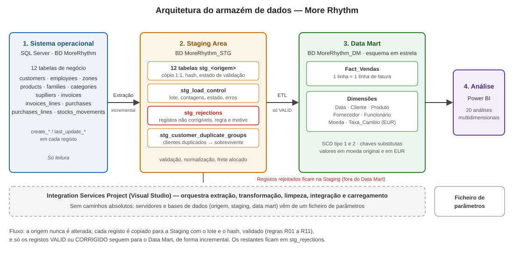
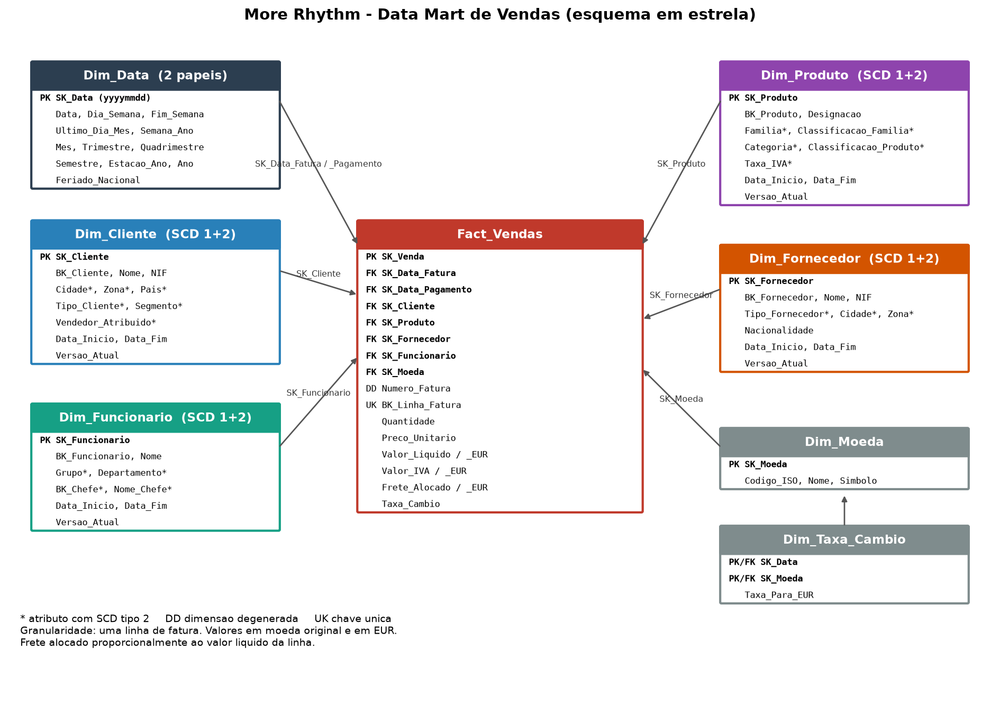
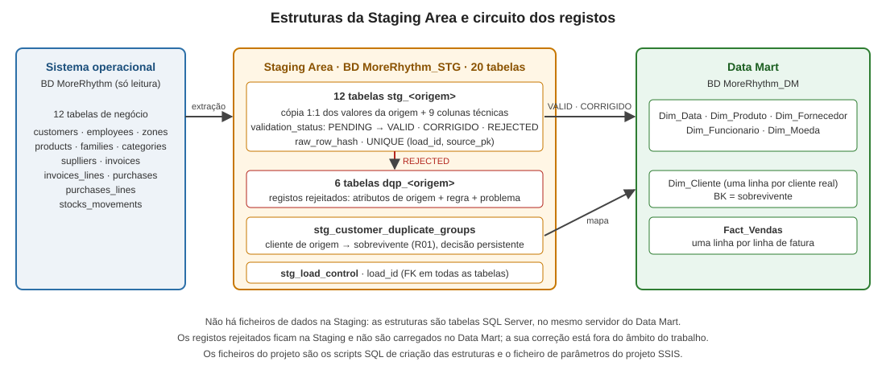

# Introdução

Este relatório documenta a 1.ª parte do trabalho prático de Armazéns de Dados: o desenho de um *data mart* de vendas para a More Rhythm, SA, empresa sediada no Porto que distribui instrumentos musicais em Portugal e, pontualmente, em Espanha. A gestão quer analisar historicamente as vendas (faturação) a clientes, ao nível de detalhe mais elementar.

O relatório apresenta a arquitetura do armazém de dados, o resultado do *Data Profiling* à base de dados operacional, o modelo dimensional (metodologia de Kimball) com os respetivos atributos e tipos de dados, as estruturas da *Staging Area*, os mapeamentos origem → Staging e Staging → Data Mart (com a estratégia de *Slowly Changing Dimension* de cada atributo) e as regras de transformação e limpeza.

Os dados disponibilizados são uma amostra da base `MoreRhythm`: 12 tabelas de negócio e 1 057 registos, dos quais 37 faturas e 93 linhas de fatura, com datas entre 31/01/2025 e 01/05/2025. Algumas análises do enunciado (por exemplo a da primavera e a do 2.º trimestre) devolvem por isso poucos dados; isso não é um erro do modelo.

# Arquitetura do armazém de dados

A arquitetura tem quatro camadas, ligadas por um processo ETL implementado num *Integration Services Project* do Visual Studio.

| Camada | Base de dados | Função |
|---|---|---|
| Sistema operacional | `MoreRhythm` | Origem dos dados. É apenas lida; o processo nunca a altera |
| Staging Area | `MoreRhythm_STG` | Guarda uma cópia fiel e rastreável dos registos extraídos, valida-os, normaliza-os e isola os que têm problemas de qualidade |
| Data Mart | `MoreRhythm_DM` | Esquema em estrela com uma tabela de factos e as dimensões, pronto para consulta |
| Análise | Power BI | As 20 análises multidimensionais pedidas |

**Fluxo.**

1. **Extração:** cada tabela de origem é copiada para a Staging, com o identificador do lote (`load_id`), a data da extração e um *hash* do registo. A extração é incremental sempre que a tabela tem colunas de auditoria (ver secção "Carga incremental").
2. **Validação e limpeza:** aplicam-se as regras R01 a R11. Cada registo fica `VALID`, `CORRIGIDO`, `PENDING` ou `REJECTED`. A normalização é feita em cópias de comparação; o valor original nunca se perde.
3. **Rejeição:** os registos que não podem ser corrigidos automaticamente ficam em `stg_rejections`, com a regra violada e o motivo, e **não** são carregados no Data Mart, como o enunciado exige.
4. **Carregamento:** as dimensões carregam antes do facto. Só entram registos `VALID` ou `CORRIGIDO`. O carregamento é incremental e idempotente.
5. **Frete e moeda:** o frete (que na origem está ao nível da fatura) é repartido pelas linhas e os valores são convertidos para euros durante a transformação.

**Parametrização.** O projeto SSIS não tem caminhos absolutos. O nome do servidor e da base de dados do sistema operacional, o servidor do Data Mart e da Staging (o mesmo para ambas) e os nomes das bases de dados do Data Mart e da Staging vêm de um ficheiro de parâmetros.

# Data Profiling

O *profiling* foi feito com seis *scripts* SQL sobre a `MoreRhythm` (inventário, chaves, valores em falta, duplicados de clientes, inconsistências financeiras e integridade referencial). A origem declara 16 chaves estrangeiras e os testes de integridade referencial não encontraram registos órfãos. Os problemas de completude e de consistência estão resumidos abaixo.

| Problema | Evidência | Tratamento |
|---|---|---|
| NIF de cliente não identificativo | 4 clientes: vazio, `0`, `00` e `000000000` | `N/D`; fora da deteção de duplicados |
| Zona de cliente em falta | 2 clientes (2 e 20) | Não se infere: o cliente é rejeitado (R03); nenhuma fatura é afetada |
| Email e telemóvel em falta | 12 e 21 clientes | Mantêm-se `NULL` |
| Atributos de produto em falta | 2 produtos sem designação, família nem categoria (`Z001`, `CORSR`); 12 produtos sem fornecedor | Os 2 produtos são rejeitados (R04); o fornecedor em falta usa o membro «Sem fornecedor» |
| Linhas de compra sem produto | 12 linhas, quantidade 319, valor 12 615,30 | Rejeitadas na Staging; fora do âmbito do data mart de vendas |
| Clientes potencialmente duplicados | Clientes 10 e 18 (mesmo NIF e nome normalizados) | Mantidos separados, em revisão |
| Linhas de fatura com `line_total` ≠ quantidade × preço | 4 linhas (2 com quantidade negativa, 2 com preço negativo) | Fatura rejeitada até confirmar a regra de sinal |
| Cabeçalho ≠ soma das linhas | 2 faturas, diferenças de +5,00 e −5,00 | Fatura rejeitada |

**Confirmado e por confirmar.** Os números acima foram confirmados por *queries* sobre a origem. A interpretação dos casos de sinal negativo (devoluções ou erro de dados) e o significado de `invoices.payment_date` (sempre preenchida, entre 03/02 e 31/12/2025 e nunca anterior à data da fatura, pelo que pode ser uma data de vencimento) dependem de confirmação do negócio e estão assinalados como decisões em aberto.

# Modelo dimensional

@@include ../modelo-dimensional/03_relatorio_seccao_modelo_dimensional.md shift=0

A figura mostra a tabela de factos e as dimensões (atributos marcados com `*` têm SCD tipo 2). O dicionário completo de dados, com tipos, chaves e nulabilidade, está no Anexo B. As restrições físicas adicionais (FK composta do facto para as taxas de câmbio, vigência SCD2 e índices únicos de versão corrente) estão descritas na secção seguinte.

## Implementação física

O esquema foi implementado em SQL Server (`04_ddl_data_mart.sql`) e validado com 33 testes automáticos (chaves, restrições, tipos, calendário e SCD2), todos aprovados numa base de dados descartável. A `Dim_Data` é populada de 2020 a 2035, com feriados nacionais (incluindo os móveis, calculados a partir da Páscoa) e as taxas de câmbio EUR = 1. Os tipos das chaves de negócio coincidem com os da origem (`numeric(10,0)` para clientes e fornecedores, `numeric(6,0)` para funcionários).

# Staging Area

A Staging Area é a camada onde os dados extraídos são preservados, validados e separados antes de chegarem ao Data Mart. Reside na base de dados `MoreRhythm_STG`, no mesmo servidor do Data Mart, e é a estrutura onde, por exigência do enunciado, ficam os registos com problemas de qualidade que não se corrigem automaticamente.

## Estruturas de dados

A Staging tem 15 tabelas: as 12 tabelas `stg_<origem>`, uma por tabela de negócio da origem, e três de apoio. A lista completa de colunas, tipos e nulabilidade está no Anexo C.

| Tabela | Função |
|---|---|
| `stg_<origem>` (12 tabelas) | Cópia de cada tabela de origem, com os mesmos nomes de coluna, tipos, precisão e nulabilidade, mais nove colunas técnicas (abaixo) e algumas colunas auxiliares de validação |
| `stg_load_control` | Uma linha por execução de carga: sistema de origem, início e fim, contagens (extraídas, validadas, rejeitadas), estado (`RUNNING`, `SUCCEEDED`, `FAILED`) e mensagem de erro |
| `stg_rejections` | Uma linha por registo e por regra violada: tabela e chave de origem, valores originais em JSON, regra (R01 a R11), mensagem e estado de resolução (`OPEN`, `RESOLVED`, `CANCELLED`) |
| `stg_customer_duplicate_groups` | Uma linha por cliente de origem pertencente a um grupo de duplicados: grupo, sobrevivente, semelhança do nome, atributos corroborantes, estado da decisão (`ACTIVE`, `DISMISSED`) e carga em que foi tomada |

As colunas auxiliares calculam-se na Staging e não existem na origem: `frete_alocado` (linhas de fatura), `line_sum` e `header_line_difference` (faturas), `normalised_name`, `normalised_taxpayer`, `normalised_email` e `normalised_address` (clientes, apenas para comparação) e `classification_fallback` (produtos).

### Tabelas e não ficheiros

O enunciado pede as «estruturas de dados (tabelas; ficheiros)» da Staging. A Staging é composta apenas por tabelas: a origem e o Data Mart são bases SQL Server e a Staging fica no mesmo servidor do Data Mart, pelo que a extração, a validação e o carregamento fazem-se por tabelas, sem etapas intermédias em ficheiros. Não existem ficheiros de dados. O único ficheiro associado ao processo é o de parametrização do projeto SSIS, com os nomes dos servidores e das bases de dados e os caminhos, que o enunciado exige que não sejam absolutos.

### Decisões de desenho

- **Cópia sem conversão.** Os valores da origem são guardados com o mesmo tipo e sem transformação; um `NULL` continua `NULL`. As normalizações usam colunas auxiliares e o valor original nunca se perde.
- **Histórico por carga.** A mesma chave de origem pode existir em cargas diferentes, mas não duas vezes na mesma (`UNIQUE (load_id, source_pk)`). O `raw_row_hash` permite reconhecer um registo já carregado e tornar a carga idempotente.
- **JSON só nas rejeições.** As tabelas `stg_<origem>` já guardam todos os registos extraídos, com os valores de origem e o estado de validação. Uma cópia em JSON de todos os registos duplicaria o volume, que no sistema real é elevado, e manteria o estado de validação em dois sítios. O JSON usa-se apenas em `stg_rejections`, para conservar os valores originais de cada registo rejeitado.
- **Decisão persistente nos duplicados.** A decisão de consolidar dois clientes fica gravada e só se desfaz por revisão explícita; recalculá-la em cada carga separaria um cliente absorvido do sobrevivente quando um atributo mudasse e partiria o histórico das faturas.
- **Rejeição ao nível da fatura.** Uma rejeição por R06, R07 ou R11 marca a fatura inteira, porque o frete é alocado sobre o conjunto das linhas. Na amostra são rejeitadas 7 das 37 faturas (10,1 % do valor).
- **Rejeitado não é eliminado.** Os registos rejeitados permanecem na Staging, com a regra e a mensagem, e não são carregados no Data Mart. A sua correção e posterior carga estão fora do âmbito do trabalho.

### Colunas técnicas

@@include ../mappings/source-to-staging.md from="## 9. Contrato físico" to="### 9.1" shift=0 drop_heading=1

### Validação das estruturas

As estruturas foram criadas e testadas em SQL Server (`mappings/03_ddl_staging_area.sql`, `05_ddl_staging_tabelas_tipadas.sql` e `06_testes_staging.sql`), numa base de dados descartável. Os 37 testes verificam a existência das tabelas, a igualdade de tipo, tamanho e nulabilidade de cada coluna de negócio face à origem (143 colunas), as colunas técnicas, as chaves e restrições e o comportamento com dados de teste (valores por omissão, duplicados, estados inválidos, rejeições e grupos de duplicados). Todos foram aprovados.

# Processo ETL: extração, validação e deteção de duplicados

Esta secção especifica a parte do processo que leva os dados da origem para a Staging e os deixa validados. O processo será implementado num *Integration Services Project* do Visual Studio; nada foi ainda construído, pelo que os nomes dos pacotes e a escolha dos componentes são a proposta para a 2.ª parte. A carga das dimensões e do facto está descrita na secção seguinte, «Processo ETL: carga do Data Mart».

## Pacotes e ordem de execução

| Ordem | Pacote (proposto) | Conteúdo | Depende de |
|---|---|---|---|
| 1 | `Mestre` | Abre o lote (`INSERT` em `stg_load_control`, estado `RUNNING`, guarda o `load_id` numa variável), chama os pacotes seguintes por ordem (*Execute Package Task*) e fecha o lote (`SUCCEEDED`) | — |
| 2 | `Extracao` | 12 tarefas de fluxo de dados independentes, uma por tabela de origem, num *Sequence Container* | Lote aberto |
| 3 | `Validacao` | Tarefas SQL em sequência: normalização, regras R05 a R11, frete alocado, rejeições | Extração completa |
| 4 | `Duplicados` | Fluxo de dados com *Fuzzy Grouping* sobre os clientes ainda sem decisão e gravação em `stg_customer_duplicate_groups` | Validação (usa as colunas `normalised_*`) |

As dimensões só carregam depois do pacote 4, porque a chave do cliente no Data Mart depende do mapa de duplicados.

## Extração de cada tabela

Cada fluxo de dados tem a mesma forma: *OLE DB Source* (consulta à origem) → *Derived Column* (`load_id`, `extraction_timestamp` e `source_pk`) → *Lookup* (último registo guardado em `stg_<origem>` com a mesma chave) → *Conditional Split* → *OLE DB Destination*.

- **Quais os registos.** Nas tabelas com datas de auditoria fiáveis (`customers`, `employees`, `families`, `invoices`, `invoices_lines`, `purchases`, `purchases_lines`, `stocks_movements`) a consulta só devolve registos com `last_update` igual ou posterior à última atualização já guardada em lotes `SUCCEEDED`. O filtro é executado na origem, por isso só os registos novos ou alterados atravessam a rede. Em `zones` e `categories`, que não têm auditoria, e em `products` e `suplliers`, onde 8 de 67 e 8 de 14 registos têm `last_update` anterior à criação, lê-se a tabela inteira.
- **Novo, alterado ou igual.** A consulta calcula o `raw_row_hash` (`HASHBYTES('SHA2_256', ...)` sobre os valores concatenados com `CONCAT` e separador, com `NULL` como texto vazio). O *Lookup* compara-o com o do último registo guardado: sem correspondência é novo, com *hash* diferente é alterado e com *hash* igual é descartado. O limite de `last_update` é inclusivo e o *hash* elimina o que já tinha sido lido, de modo que repetir uma carga não cria registos.
- **Destino.** O *OLE DB Destination* em modo *fast load*. Os valores entram com o tipo da origem; não há conversões. O estado inicial é `PENDING`.

## Validação e limpeza

As regras aplicam-se em tarefas SQL sobre o lote inteiro, não registo a registo:

1. **Normalização** (R02, R09): preencher as colunas `normalised_*` e tratar como ausente o valor vazio, só com espaços ou com formato inválido, nas colunas transformadas; o valor original fica na coluna copiada.
2. **Linhas e faturas** (R05, R06, R07, R11): marcar a linha de compra sem produto; comparar `line_total` com `quantity × unit_price`; calcular `line_sum` e `header_line_difference`; comparar `final_total` com `products_total + shipping_cost + vat_value`. A tolerância monetária é 0,01. Uma violação de R06, R07 ou R11 marca a fatura inteira como `REJECTED`.
3. **Integridade** (R08): validar as referências não nulas entre tabelas do lote, incluindo as que apontam para clientes ou produtos rejeitados (R03 e R04); nesse caso a fatura inteira é rejeitada.
4. **Frete**: nas faturas não rejeitadas, `frete_alocado` é proporcional ao valor da linha, com o resto de arredondamento na última linha.
5. **Estado**: os restantes registos passam a `VALID` ou `CORRIGIDO`; os rejeitados são copiados para `stg_rejections` com a regra, a mensagem e os valores originais em JSON (`FOR JSON PATH`).

O tratamento de clientes sem zona e de produtos sem atributos (R03 e R04) segue a decisão indicada em «Decisões em aberto e limitações».

## Deteção de duplicados de clientes (R01)

O fluxo de dados lê os clientes do lote que ainda não têm decisão em `stg_customer_duplicate_groups`, juntamente com os sobreviventes `ACTIVE`, e passa o nome normalizado pelo componente *Fuzzy Grouping*, que agrupa por semelhança e devolve a chave do grupo e a pontuação. O componente só mede a semelhança do nome; o critério completo da regra R01 (pelo menos dois atributos corroborantes) aplica-se a seguir, numa tarefa SQL sobre os pares candidatos, que também escolhe o sobrevivente (atualização mais recente). Ficam gravados os grupos em que pelo menos um membro ainda não tinha decisão. O *Fuzzy Grouping* precisa de uma ligação a SQL Server para criar tabelas temporárias.

A semelhança do *Fuzzy Grouping* não é a distância de Levenshtein usada no *profiling* (limiar 0,80). O limiar do componente tem de ser calibrado na 2.ª parte sobre os mesmos pares; o resultado esperado na amostra é o mesmo, três grupos com sobreviventes 18, 8 e 5.

## Erros e rejeições

- **Dados com problemas de qualidade:** rejeição lógica para `stg_rejections` (secção anterior); o registo fica na Staging e não segue para o Data Mart.
- **Erros técnicos** (ligação, tipos, destino): as saídas de erro das origens e destinos falham o componente. Um manipulador de eventos `OnError` no pacote `Mestre` marca o lote `FAILED` com a mensagem de erro. Como o limite de extração só usa lotes `SUCCEEDED`, repetir a execução volta a ler o que ficou por carregar.
- **Contagens:** componentes *Row Count* guardam em variáveis o número de registos extraídos, validados e rejeitados, que o pacote `Mestre` grava em `stg_load_control`.

## Parâmetros

Nenhum componente tem caminhos absolutos. As ligações são construídas por expressões a partir de parâmetros do projeto, guardados no ficheiro de parâmetros (`Project.params`):

| Parâmetro | Conteúdo |
|---|---|
| `Origem_Servidor` | Servidor da base de dados do sistema operacional |
| `Origem_BD` | Nome da base de dados do sistema operacional (`MoreRhythm`) |
| `DW_Servidor` | Servidor do Data Mart e da Staging (o mesmo para ambos) |
| `DM_BD` | Nome da base de dados do Data Mart (`MoreRhythm_DM`) |
| `STG_BD` | Nome da base de dados da Staging (`MoreRhythm_STG`) |
| `Tolerancia_Monetaria` | 0,01 |
| `Limiar_Semelhanca_Nome` | Limiar do *Fuzzy Grouping* (a calibrar) |
| `Min_Atributos_Corroborantes` | 2 |

Os cinco primeiros são os que o enunciado exige; os restantes evitam valores fixos nas regras.

## Medidas de eficiência

- Só atravessam a rede os registos novos ou alterados nas oito tabelas com auditoria fiável; as consultas escolhem apenas as colunas necessárias e calculam o *hash* na origem.
- Os 12 fluxos são independentes e correm em paralelo.
- A extração não usa componentes bloqueantes (*Sort*, *Aggregate*). O *Lookup* usa cache total nas tabelas pequenas lidas por inteiro e cache parcial ou nenhuma nas grandes, em que só chegam poucos registos.
- A validação é feita por instruções SQL sobre conjuntos e não por *OLE DB Command* registo a registo.
- O destino usa *fast load*, com tamanho de confirmação ajustável ao volume real.
- Cada tabela `stg_<origem>` tem índice na chave de negócio, que suporta a pesquisa do último registo.
- O *Fuzzy Grouping*, que é caro, só processa os clientes sem decisão e não a tabela inteira.

Não foram feitas medições de desempenho nesta fase: a amostra é pequena e o enunciado indica que o volume real é muito superior. As medições ficam para a 2.ª parte.

# Processo ETL: carga do Data Mart

@@include secao_carga_etl.md shift=0

# Mapeamentos

## Origem → Staging

A cópia é 1:1: cada tabela de origem tem a sua `stg_<origem>`, com as mesmas colunas, tipos, precisão e nulabilidade; os `NULL` mantêm-se `NULL` e nenhuma conversão é destrutiva. A tabela técnica `sysdiagrams` não é copiada. As regras de validação aplicadas na passagem para a Staging são as seguintes.

@@include ../mappings/source-to-staging.md from="### 9.2" to="### 9.3" shift=0 drop_heading=1

## Staging → Data Mart

A Staging Area guarda uma cópia fiel e rastreável dos registos extraídos da origem, valida-os e isola os que têm problemas de qualidade. O data mart recebe apenas os registos válidos ou corrigidos automaticamente. O mapeamento descreve, para cada atributo do data mart, de onde vem, que transformação sofre e qual é a sua estratégia SCD; as tabelas atributo a atributo seguem-se a esta apresentação.

**Dimensões.** Em geral, as transformações de limpeza são aplicadas só à cópia usada no carregamento, e o valor original permanece na Staging. Os textos são aparados e os vazios passam a nulo. O NIF vazio ou composto só por zeros passa a "N/D" e fica fora da deteção de duplicados (quatro clientes na amostra). A zona do cliente vem da tabela de zonas e o país deriva dela (Espanha, ou Portugal para as restantes). O vendedor atribuído é o nome do funcionário correspondente, e o valor zero na origem significa "sem vendedor". Para o produto, a família, a categoria e a classificação vêm das tabelas respetivas; quando o produto não tem classificação própria, usa-se a da família, e esse recurso fica assinalado na Staging. No fornecedor e no funcionário aplicam-se as mesmas regras de limpeza; o chefe do funcionário traz o nome do chefe, e a direção, sem chefe, fica a nulo. Na dimensão do cliente só entram os sobreviventes do mapa de duplicados, com os atributos consolidados do grupo.

**Tabela de factos.** Cada linha de fatura origina uma linha do facto. Para as chaves das dimensões, o carregamento pesquisa a versão vigente à data da fatura: o cliente passa primeiro pelo mapa de duplicados, o fornecedor vem do produto vendido (ou do membro "Sem fornecedor" quando o produto não tem fornecedor) e a moeda `EURO` da origem corresponde a `EUR`. A quantidade, o preço, o total e o IVA da linha copiam-se sem alterar o sinal. O frete é o valor já alocado na Staging, e os valores em euros resultam de multiplicar pela taxa do dia da fatura, com seis casas decimais. A data de última atualização é a mais recente entre a linha e o cabeçalho, e o *hash* da linha combina os da linha e do cabeçalho, porque uma alteração ao frete no cabeçalho muda a alocação de todas as linhas sem alterar as linhas. A ligação ao lote de carga permite saber que execução inseriu ou atualizou cada linha. Só entram faturas sem as três inconsistências descritas acima.

@@include ../mappings/04_mapeamento_staging_datamart.md shift=1

# Regras de transformação, limpeza e rejeição

@@include ../mappings/transformacoes-limpeza.md from="## 2. Regras de tratamento" to="## 3. Classificação" shift=0 drop_heading=1

Os registos são classificados como correção automática segura, atributo opcional em falta, problema por investigar ou registo rejeitado. Um atributo opcional em falta não rejeita a venda; uma chave, medida ou relação inválida rejeita-a.

@@include ../mappings/transformacoes-limpeza.md from="## 8. Contrato" shift=0

# Carga incremental

O enunciado exige que cada execução carregue só os dados novos e atualize os que mudaram. A estratégia tem duas fases, descritas nas duas secções anteriores:

- **Extração (Staging).** Nas tabelas com datas de auditoria fiáveis, só se leem os registos com `last_update` igual ou posterior ao último lote bem-sucedido; nas restantes, lê-se tudo. Em todas, o *hash* da linha (`raw_row_hash`) decide se um registo é novo, alterado ou igual, de modo que repetir uma carga não cria registos.
- **Carga (Data Mart).** Nas dimensões, o `Hash_SCD1` e o `Hash_SCD2` decidem entre ignorar, atualizar (tipo 1) ou abrir uma nova versão (tipo 2). No facto, o *upsert* por `BK_Linha_Fatura` só reaplica as linhas cujo `Hash_Linha` mudou; este *hash* inclui o cabeçalho da fatura, porque uma alteração ao frete muda a alocação de todas as linhas.
- **Limitação.** A origem não marca eliminações, pelo que os registos apagados na origem não são detetados.

# Uniformização monetária em euros

O enunciado prevê que a empresa expanda a sua atividade para outros países da União Europeia e abra uma sucursal no Reino Unido, pelo que o data mart tem de permitir analisar vendas em moedas diferentes, usando o euro como moeda de uniformização. Os valores monetários do facto são guardados na moeda original e em euros, juntamente com a taxa de câmbio aplicada, o que mantém a rastreabilidade do valor original e permite agregar em euros sem recalcular. A taxa é a da moeda no dia da fatura e está numa tabela com uma linha por moeda e dia; para o euro a taxa é 1.

Na amostra só existe a moeda `EURO`, mapeada para `EUR`. A estrutura e a moeda `GBP` já estão previstas, pelo que a sucursal do Reino Unido não obriga a alterar o modelo, mas nesta fase só se implementa o euro: a carga de cotações de outras moedas, e a regra para os dias sem cotação, ficam como extensão futura. Se não existir taxa para a moeda e o dia de uma fatura, o registo é rejeitado, em vez de se usar a taxa do dia anterior; a própria base de dados impõe esta regra, através de uma chave estrangeira composta do facto para a tabela de taxas.

---

# Decisões em aberto e limitações

## Decisões ainda por fechar

| Ponto | Hipótese assumida | Alternativa |
|---|---|---|
| Linhas de fatura com sinal negativo (4) | A fatura é rejeitada até o negócio confirmar a regra | Carregar como devoluções |
| Significado de `payment_date` | É sempre preenchida e posterior à fatura, pelo que pode ser uma data de vencimento | Data de pagamento |
| `shipping_cost` das 2 faturas com total incoerente | A fatura é rejeitada, porque não se sabe qual dos dois fretes é o efetivo | Carregar com o valor do cabeçalho |
| Clientes sem zona e produtos sem atributos | Decidido: rejeitar; na amostra não afeta nenhuma fatura (clientes 2 e 20; produtos Z001 e CORSR) | Carregar como "Desconhecida" |
| Origem das taxas de câmbio | Decidido: só euros nesta fase; GBP e ficheiro de cotações como extensão | Implementar já as cotações |
| Fornecedores 8 e 14, com o mesmo NIF | Estabelecimentos distintos, não consolidados | Fundir |

## Expansão e IVA por país

**[CONFIRMAR: toda esta secção é raciocínio meu sobre o modelo; não é decisão do grupo nem está no repositório. Discutam e adaptem]**

A sucursal no Reino Unido pode exigir mais do que moeda. Hoje o país do cliente deriva da zona, o que basta para analisar as vendas por país. Se as vendas da sucursal forem emitidas por uma entidade diferente, justifica-se uma dimensão própria de sucursal; enquanto a empresa fatura a partir de uma única entidade, o país e a moeda chegam. O IVA também varia por país. Hoje a taxa é um atributo do produto, com histórico, o que é suficiente com uma única taxa. Com vários países a taxa passa a depender do produto e do país. No entanto, as análises não dependem dela, porque o facto guarda o IVA efetivamente faturado em cada linha; a taxa só seria necessária para validar esses valores.

## Clientes internos e funcionários

A amostra tem três clientes do tipo "Interno" (a própria empresa e as suas filiais), sem qualquer fatura, e um do tipo "Funcionário", com uma fatura de 971,37. Os internos não afetam as análises. O cliente funcionário é uma venda real, por isso entra no data mart, e o tipo de cliente permite excluí-lo de uma análise de vendas a clientes externos, se a gestão o pretender.

## Limitações conhecidas

- As estações do ano usam datas fixas (20/03, 21/06, 23/09 e 21/12); os equinócios e solstícios reais variam um dia entre anos, sem efeito nas análises pedidas. **[CONFIRMAR: a afirmação de que a diferença não afeta as análises é minha; confirmar com as datas reais de 2025]**
- A origem não regista eliminações, pelo que os registos apagados na origem não são detetados.
- Um duplicado detetado depois de os dois clientes já estarem carregados exige reapontar as faturas já carregadas; o cliente de origem guardado no facto permite fazê-lo, e fica especificado, mas não é implementado nesta fase.
- O fornecedor da linha de fatura reflete o produto na altura da carga e não é historiado.
- A origem não guarda os valores antigos dos atributos; o histórico das dimensões começa na primeira carga.

# Anexo A — Matriz de requisitos analíticos

@@include ../modelo-dimensional/01_matriz_requisitos_analiticos.md shift=0

# Anexo B — Dicionário de dados e estratégias SCD

@@include ../modelo-dimensional/02_modelo_dimensional_dicionario_scd.md from="## 3. Dicionário" to="## 6. Clientes" shift=0

@@include anexo_c_staging.md shift=0
